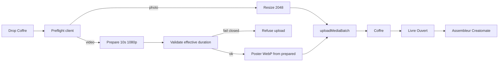

# Coffre · montage · ingest médias

**Type :** living · **Vérité pour :** audit Coffre + Livre Ouvert + décision ingest client (trim 10 s + compress).  
**Dernière MAJ :** 28 oct 2026 · **Carte :** [`../README.md`](../README.md)  
**Chantier actif :** [`WIZARD_COFFRE_LIVRE_PACKAGES.md`](WIZARD_COFFRE_LIVRE_PACKAGES.md) Phase 2 (= **S7** ⏳ ; S5–S6 ✅).  
**Démo 18 sept 2026 :** passée — P0 S1–S3 ✅ · S5–S6 ✅ · S7 ouvert.

**Changelog** (max 5)
- 28 oct 2026 : Doublon exact : SHA-256 du fichier original avant préparation. Choix d’ajouter ou non, photos comprises. S7 ⏳.
- 28 oct 2026 : Commit 11 : le Coffre prépare la vidéo depuis l’original, envoie seulement le fichier préparé, choisit l’extrait si le film dépasse 10 secondes. S7 ⏳.
- 28 oct 2026 : Commit 10 : annuler avant le POST jette l’objet. POST réussi : on garde. POST incertain : réconcilier avant discard ou retry. S7 ⏳.
- 28 oct 2026 : Commit 9 file : statut `preparing`, original en mémoire, reprise sur l’original. Pas encore d’encode dans l’upload.
- 28 oct 2026 : porte QA pré-Coffre verte (H.264/HFR/trim/AAC/annuler + fixture HEVC OK ; Photos HEVC différé) · prérequis Commit 11 · pas de branchement.

Canon étape 5 : [`../STORYBOARD_STEP5_LIVRE_OUVERT.md`](../STORYBOARD_STEP5_LIVRE_OUVERT.md).  
Export film : [`../craft/CREATOMATE_RECIPE.md`](../craft/CREATOMATE_RECIPE.md).  
Pacing : `VIDEO_TRIM_DURATION_SEC` = 10 dans [`src/lib/wizard/storyboardPacing.ts`](../../src/lib/wizard/storyboardPacing.ts).

---

## 1. Symptômes (ce que la famille voit)

| # | Symptôme | Cause réelle |
|---|----------|----------------|
| A | Upload vidéo → *The object exceeded the maximum allowed size* | Limite **Supabase Storage** (souvent 50 Mo), pas le plafond app (300 Mo) |
| B | « Je ne vois pas la vidéo » dans le Coffre | **S5 ✅** poster WebP ; legacy sans thumb = Film / preview metadata ; MIME vide `.mp4`/`.mov` = **S3** |
| C | Vidéo absente / cassée à la table de montage | URL **MP4 passée à un ``** (banque, cartes, directeur) |
| D | Composer desktop « plus comme avant » | Shell `max-w-3xl` + fade `transform` (piège `fixed` / casse dnd-kit) |
| E | Export = toujours les 10 premières secondes | `videoTrims` jamais écrit par l’UI |

---

## 2. Audit par surface

### Coffre (étape 3)

Fichiers : [`TributeWizard.tsx`](../../src/components/tribute/TributeWizard.tsx) · [`src/surfaces/coffre/`](../../src/surfaces/coffre/) · [`MediaQueueGrid.tsx`](../../src/components/media/MediaQueueGrid.tsx) · [`MediaDropzoneAdapter.tsx`](../../src/components/media/MediaDropzoneAdapter.tsx) · [`mediaUploadService.ts`](../../src/lib/uploads/mediaUploadService.ts).

- Accept : `video/mp4`, `video/quicktime`. Fallback extension **HEIC/HEIF + `.mp4`/`.mov`** si `file.type === ""` (S3).
- Thumb photo : [`generateImageThumbnail.ts`](../../src/lib/media/generateImageThumbnail.ts). **S5 ✅** poster vidéo : [`generateVideoPoster.ts`](../../src/lib/media/generateVideoPoster.ts) → `*-thumb.webp` (legacy sans thumb = Film / preview metadata).
- Grille : tuile image si thumb ; sinon fallback Film. Upload vidéo encore **as-is** jusqu’à S7.
- Soft Cap / `excludedIds` : **ne filtrent pas** la grille Coffre.
- Scanner compagnon : photos seulement (aussi dans le tiroir).
- **S7 ⏳** : préparation client avant upload (contrat §7). Pas encore de picker UI ni de branchement.

### Livre Ouvert / table de montage (étape 5)

Composer **actif** : [`StoryboardMontageStep.tsx`](../../src/components/tribute/StoryboardMontageStep.tsx) + `@dnd-kit`.  
Legacy **orphelin** : [`MontageTimeline.tsx`](../../src/components/tribute/storyboard/MontageTimeline.tsx), [`MediaBankPanel.tsx`](../../src/components/tribute/storyboard/MediaBankPanel.tsx).

- Nouveaux médias → `unassignedIds` via [`storyboardMedia.ts`](../../src/lib/wizard/storyboardMedia.ts) (banque). L’ID peut être là, la **vignette** cassée.
- Hydratation : pas de thumb signé pour vidéo → `previewUrl` = fichier MP4 ([`hydrateMediaSignedUrls.server.ts`](../../src/lib/media/hydrateMediaSignedUrls.server.ts)).
- `` : [`BankDraggableMediaTile.tsx`](../../src/components/tribute/storyboard/BankDraggableMediaTile.tsx), [`MontageMediaCard.tsx`](../../src/components/tribute/montage/MontageMediaCard.tsx), [`MontageDirectorModal.tsx`](../../src/components/tribute/montage/MontageDirectorModal.tsx) (~219).
- Fetch étape 5 avec `{ force: true }` à l’entrée (S3) — évite le cache Coffre périmé. `catch` toujours best-effort.
- [`useFinePointer.ts`](../../src/hooks/useFinePointer.ts) : `useState(false)` → premier paint desktop = capteur **Touch** + poignées mobile ([`useMontageDnd.ts`](../../src/hooks/useMontageDnd.ts), commit ~`222bde4`).
- `videoTrims` : modèle + autosave + Creatomate OK ; picker UI = lab Commit 8 seulement (pas encore Coffre).

### Export

[`resolveMediaAssets.ts`](../../src/lib/creatomate/resolveMediaAssets.ts) : `trimStartSec` défaut 0, durée 10 s. Atome [`media-video.json`](../craft/atoms/media-video.json).

---

## 3. Décision ingest (après la démo)

**Le client prépare avant upload.** Un seul objet Storage (pas d’original V1). Détail vidéo : **§7 Contrat S7 v2.3**.

| Média | Cible |
|--------|--------|
| Vidéo | Fenêtre **10,0 s** max (durée **effective** du fichier préparé) + 1080p H.264/AAC · voir §7 |
| Photo | Côté long max **2048 px**, JPEG/WebP ~0.82 |
| Hors V1 | Scanner, musique MP3 (déjà ~40 Mo), worker ffmpeg serveur · Sanctuaire **photo** = S6b ✅ (même `resizeImageForUploadFile`) |

Creatomate : clip déjà court → `trim_start` = 0. Re-trim directeur = plus tard **seulement si** on stocke plus que 10 s (hors V1).

Ops parallèle : **Dashboard Supabase → Storage → global file size** 100–300 Mo (filet).

---

## 4. Étapes chirurgicales — démo vendredi 18 sept

Objectif démo : **déposer une vidéo, la voir dans le Coffre, la glisser dans un chapitre desktop, l’ouvrir dans le directeur**. Pas besoin du re-encode vendredi.

### Jeudi (P0 — bloquant démo)

| # | Commit visé | Fichiers | Done when |
|---|-------------|----------|-----------|
| **S1** | Preview vidéo unifiée | `MediaAssetThumb` / `MediaVideoPreview` | **Fait** — jamais `` sur URL `video/*` |
| **S2** | Desktop DnD | `useFinePointer` via `useSyncExternalStore` | **Fait** — souris dès le 1er paint client |
| **S2b** | Drag tuile | Listeners PointerSensor sur l’aperçu (banque + cartes) | **Fait** — clic ouvre le directeur, glisser dépose ; pas de double fantôme |
| **S2c** | Largeur + modal | Shell Étape 5 `max-w-7xl` ; fade sans `transform` ; directeur/composition portés au body | **Fait** — Livre Ouvert + salle de visionnement plein écran desktop |
| **S3** | Banque à jour + drop | `StoryboardMontageStep` fetch `force` à l’entrée étape 5 ; fallback `.mp4`/`.mov` dropzone | **Fait** — refetch Coffre ; iPhone/Finder sans MIME acceptés |
| **S4** | Ops (pas de code) | Supabase file size limit | Une vidéo test ~80–150 Mo passe **ou** on démo avec un fichier &lt; limite actuelle |

Copy FR/EN si nouveau texte écran (ex. « Souvenir filmé ») — dictionnaires + catalog.

### Après vendredi (P1 ingest)

| # | Quoi |
|---|------|
| **S5** | ✅ Poster frame client à l’upload (canvas), même pipeline que thumb photo |
| **S6** | ✅ Resize photos 2048 px preflight (JPEG 0.82 · HEIC skip) |
| **S7** | ⏳ Contrat §7 · trim/encode client · copy préparation (UI aux commits 8+) |

S7 = le plus gros. S1–S3 déjà verts. Rien ne change pour les familles tant que le branchement (commit 11) n’est pas livré.

### Hors démo

- Worker serveur / conservation original
- Re-trim dans le directeur
- WebM wizard (Sanctuaire seulement aujourd’hui)

---

## 5. Ancres code

| Besoin | Fichier |
|--------|---------|
| Preflight upload | [`mediaUploadService.ts`](../../src/lib/uploads/mediaUploadService.ts) |
| Dropzone | [`MediaDropzoneAdapter.tsx`](../../src/components/media/MediaDropzoneAdapter.tsx) |
| Grille Coffre | [`MediaQueueGrid.tsx`](../../src/components/media/MediaQueueGrid.tsx) |
| Étape 5 | [`StoryboardMontageStep.tsx`](../../src/components/tribute/StoryboardMontageStep.tsx) |
| DnD | [`useMontageDnd.ts`](../../src/hooks/useMontageDnd.ts) · [`useFinePointer.ts`](../../src/hooks/useFinePointer.ts) |
| Directeur | [`MontageDirectorModal.tsx`](../../src/components/tribute/montage/MontageDirectorModal.tsx) |
| Plafond API | [`upload-url/route.ts`](../../app/api/projects/[id]/media/upload-url/route.ts) (zod 300 Mo) |
| Nettoyage orphelins | [`discardStorageObjects.ts`](../../src/lib/uploads/discardStorageObjects.ts) · [`discard/route.ts`](../../app/api/projects/[id]/media/discard/route.ts) |
| Contrat durée S7 | [`videoDurationContract.ts`](../../src/lib/media/videoDurationContract.ts) (helpers + tests ; pas encore branché) |
| Probe conteneur MP4 | [`probeMp4Container.ts`](../../src/lib/media/probeMp4Container.ts) · dep `mp4box` · fixtures `tests/fixtures/mp4/` |
| Décodage + dimensions S7 | [`verifyBrowserVideoDecode.ts`](../../src/lib/media/verifyBrowserVideoDecode.ts) · [`orientedVideoDimensions.ts`](../../src/lib/media/orientedVideoDimensions.ts) (indépendant du probe) |
| Encode WebCodecs S7 | [`encodeVideoWithWebCodecs.ts`](../../src/lib/media/encodeVideoWithWebCodecs.ts) · mux `mediabunny` · mesure [`measurePreparedVideoDuration.ts`](../../src/lib/media/measurePreparedVideoDuration.ts) |
| Fallback MediaRecorder S7 | [`encodeVideoWithMediaRecorder.ts`](../../src/lib/media/encodeVideoWithMediaRecorder.ts) · MP4 via [`ensurePreparedMp4Bytes.ts`](../../src/lib/media/ensurePreparedMp4Bytes.ts) (jamais WebM nu) |
| Orchestrateur S7 | [`prepareVideoForUpload.ts`](../../src/lib/media/prepareVideoForUpload.ts) (Commits 2–7 ; pas branché Coffre) |
| Modale trim 10 s (Commit 8) | [`VideoTrimModal.tsx`](../../src/components/media/VideoTrimModal.tsx) · lab [`test-s7-prepare`](../../app/[lang]/test-s7-prepare/page.tsx) seulement |
| Secours HEVC canvas | [`encodeMp4ViaHtmlVideoCanvas.ts`](../../src/lib/media/encodeMp4ViaHtmlVideoCanvas.ts) (H.264 + AAC trim si décodable) |

### 5b. Nettoyage Storage après échec d'enregistrement

Le bucket `user-assets` n'a pas de policy DELETE pour `authenticated` : le navigateur ne peut pas supprimer. Si l'upload Storage réussit mais que `media_assets` échoue (quota, RLS, réseau), le client appelle `POST /api/projects/[id]/media/discard` à **chaque tentative ratée** ; `register` nettoie aussi côté serveur. L'erreur initiale reste toujours celle remontée.

Garde-fous serveur (client admin) : accès `resolveWizardCraftAccess` (Titulaire ou Co-Créateur) · chemins sous `projects/{id}/` uniquement · miniature dérivée côté serveur, jamais acceptée en entrée · **un chemin référencé par `media_assets` n'est jamais supprimé** (le trigger quota est `BEFORE INSERT` et se déclenche aussi sur un upsert en conflit ; une réponse perdue après insertion réussie arrive au même cas).

Validation sur Supabase réel (quota atteint sur un projet test, objets absents du bucket ensuite) : **reste à faire**. Les tests du dépôt sont des mocks.

Limites connues :
- Un fichier envoyé mais pas encore enregistré n'est pas protégé par le contrôle de référence (chemin à UUID non devinable). Accepté en V1.
- Réponse perdue après une insertion réussie : le fichier est conservé, mais la tentative suivante crée un **doublon** du média. Problème distinct, non traité ici.
- Orphelins déjà présents dans le bucket : pas de rattrapage.

---

## 6. QA démo (checklist)

1. Photo → Coffre (miniature).
2. Vidéo courte (&lt; limite Storage) → tuile **lisible** (pas icône morte).
3. Étape 5 desktop : vidéo dans la banque, **drag** souris vers un chapitre, aperçu directeur = **image ou lecture**, pas rectangle cassé.
4. Export drain (si temps) : intro 27 s + clip photo + clip vidéo 10 s + outro sans Odyssey.

---

## 7. Contrat S7 v2.3 (garanties produit)

Statut : **S7 ⏳**. Ce paragraphe fixe le contrat. Les helpers, encodeurs, UI et branchement sont des commits ultérieurs. Aucun comportement production modifié par ce document seul.

### 7.1 Trois durées

| Concept | Définition | Règle |
|---------|------------|--------|
| Durée source | Mesurée sur le fichier choisi par la famille | 9,98 s admissible si les autres contrôles passent ; 10,02 s → découpe ou réencodage obligatoire ; inconnue ou incohérente → refus |
| Durée demandée | Consigne passée à l’encodeur (`VIDEO_TRIM_DURATION_SEC` = 10) | Une consigne de 10 s **ne prouve pas** que le fichier produit respecte le plafond |
| Durée effective | Mesurée sur le **fichier préparé** (sortie) | **Rejet absolu si &gt; 10,0 s**, même si l’encodeur a reçu 10 s |

La durée effective fait foi. Aucune vidéo n’est remise à l’upload si sa durée effective dépasse 10,0 s.

### 7.2 Fail-closed

- Fast-path (conteneur + décodage) **et** validation de sortie après préparation : les deux existent ; une consigne d’encodage ne remplace pas la mesure de sortie.
- Si la durée ou le contenu ne peut pas être vérifié → la préparation **échoue**.
- Métadonnée ambiguë ≠ validation → refus du fast-path, passage par l’encodage (ou rejet).
- Échec de préparation → **jamais** d’upload de l’`originalFile` brut. L’original n’est pas un fallback.
- Soft Cap / quota : comptés seulement après succès d’enregistrement `media_assets` (voir aussi §5b).

### 7.3 Résolution V1

- Portrait : au plus **1080×1920** (après orientation).
- Paysage : au plus **1920×1080** (après orientation).
- Carré : chaque côté ≤ **1080**.
- Zéro déformation (pas d’étirement pour « forcer » le cadre).
- Framerate V1 (**décision CEO 28 oct = option A**) : **accepter** les sources 60/120 fps ; **sortie forcée ~30 fps** (downsample, même durée timeline = pas de ralenti). Pas de conservation 60/120. Conversion : `frameRate: 30`. Secours canvas : sample pendant lecture temps réel. Slo-mo iPhone (présentation ralentie) = cas à part, hors cette décision.

**Commit 4 :** [`verifyBrowserVideoDecode.ts`](../../src/lib/media/verifyBrowserVideoDecode.ts) prouve une frame décodée (seek + canvas) et valide les dimensions orientées. Indépendant de `probeMp4Container` : un conteneur admissible ne suffit pas. Annulation → `video_prepare_cancelled` (résultat tardif ignoré). Pas encore branché à l’upload.

Réserve suivi : les tests unitaires du décodage utilisent un **host mocké sous Node**. Ils valident la logique (dimensions, abort, erreurs) mais **ne prouvent pas** encore le comportement réel de Safari sur iPhone. Fixtures MP4 portrait/paysage conservées sous `tests/fixtures/mp4/` pour l’E2E ultérieur (porte QA / Commit 12).

### 7.4 Conteneur et codecs (contrat)

Conditions de fast-path, toutes vérifiables de façon fiable :

- 1 piste vidéo **H.264 8-bit** ;
- 0 ou 1 piste audio **AAC** (vidéo muette acceptée) ;
- rotation / orientation lisible ;
- boîte `moov` en début **ou** en fin de fichier.

Refus du fast-path (encode ou rejet propre) notamment si :

- HEVC (`hvc1` / `hev1`) ;
- profondeur ou codec non vérifiable ;
- piste / rotation / `moov` ambigus.

L’extension `.mp4` ne prouve pas le codec.

**Dépendance probe (Commit 3) :** [`mp4box`](https://www.npmjs.com/package/mp4box) (GPAC) pour pistes/codecs + localisateur d’atomes top-level dans [`probeMp4Container.ts`](../../src/lib/media/probeMp4Container.ts) (position `moov` début/fin). Pas de parseur codec maison. `eligibleForFastPath` = « assez vérifiable pour envisager le fast-path » (ensuite Commit 4 décodage) ; **pas** « prêt à uploader ». Profondeur de bits 8 non prouvée par le conteneur seul → listée dans `unverifiedFields`.

### 7.5 Encodeurs (intentions V1)

- Chemin principal (**Commit 5**) : WebCodecs via [`mediabunny`](https://mediabunny.dev) `Conversion` → MP4 (`Mp4OutputFormat` + `BufferTarget`). Résolution V1 sans déformation (`fitVideoEncodeSize` + `fit: 'contain'`). Audio AAC préservé quand présent. Orientation bakée (`allowTransformationMetadata: false`).
- Après mux : durée **effective** lue dans le moov (`measurePreparedVideoDuration` / mp4box), puis `assessOutputDuration`. Une consigne de 10 s ou un compte de frames **ne suffit pas**. Si non mesurable → refus (`video_duration_unknown`), jamais l’original brut.
- **Contrat conteneur après WebCodecs :** le mux ne peut pas renvoyer un HEVC / hors contrat en `ok`. [`assertPreparedMp4Container`](../../src/lib/media/ensurePreparedMp4Bytes.ts) ; si KO → remux/transcode forcé (`remuxBlobToMp4`, `avc`) ; si encore KO → `video_encode_failed` pour déclencher MediaRecorder. Évite le faux positif QA (`ok` puis `video_fast_path_ineligible` en validation finale).
- **HEVC iPhone :** `Conversion` peut rester `isValid` avec **audio seul** si la vidéo HEVC est indécodable par `VideoDecoder` → on exige une piste vidéo utilisée + conteneur H.264 admissible, sinon secours [`encodeMp4ViaHtmlVideoCanvas`](../../src/lib/media/encodeMp4ViaHtmlVideoCanvas.ts) (`<video>` natif → canvas → H.264 + AAC source trimé). Si l’audio source est indécodable : soft-fail vidéo seule. **À retester :** HEVC + son, preview Safari démutée. MediaRecorder fichier inutilisable sur iOS (`captureStream` absent).
- Réserve suivi Commit 5 : tests Node mockent `encodeToMp4` ; ils ne prouvent pas WebCodecs réel (Chrome/Safari). E2E encode = porte QA / commits ultérieurs.
- Secours (**Commit 6**) : [`encodeVideoWithMediaRecorder.ts`](../../src/lib/media/encodeVideoWithMediaRecorder.ts). Mime préféré `video/mp4`, sinon WebM. Piste audio silencieuse via `AudioContext` (GainNode à 0 → `MediaStreamDestination`, **jamais** `destination` haut-parleurs) ; `resume()` uniquement dans ce chemin, à invoquer depuis un geste utilisateur. Annulation : stop recorder + pistes + fermeture AudioContext.
- **Contrat MP4 après MediaRecorder :** le blob brut n’est jamais le fichier préparé. [`ensurePreparedMp4Bytes`](../../src/lib/media/ensurePreparedMp4Bytes.ts) exige un ISO-BMFF **et** un `probeMp4Container` admissible (`eligibleForFastPath` : H.264, AAC optionnel, moov présent). Un `ftyp` seul ne suffit pas. ISO-BMFF hors contrat (ex. **HEVC Safari**) ou WebM → remux/transcode mediabunny → MP4 + même probe ; échec de conversion → `video_encode_failed`, jamais le blob brut. Durée effective mesurée ensuite sur ce MP4 final.
- Réserve suivi Commit 6 : les tests unitaires mockent `host.record` / `ensureMp4` / `measureDuration` sous Node. Ils valident le contrat (indisponible, échec, annulation, durée inconnue ou &gt; 10 s, refus WebM nu). Ils **ne prouvent pas** MediaRecorder réel ni Safari sur iPhone. Validation device = porte QA tranche 1 / Commit 12.
- Creatomate : `trim_start` = 0 (le clip stocké est déjà court).
- Orchestrateur (**Commit 7**) : [`prepareVideoForUpload`](../../src/lib/media/prepareVideoForUpload.ts). Enchaîne probe → décodage source → choix fast-path **ou** WebCodecs puis MediaRecorder → **validation finale obligatoire** (probe + décodage + dimensions V1 + durée effective ≤ 10,0 s). Fast-path seulement si les quatre sont vrais **et** `trimStart = 0` ; un conteneur admissible ne suffit pas. Durée source inconnue → refus. MediaRecorder uniquement après `video_encode_failed` WebCodecs (pas après annulation ni échec de contrat durée). Échec → jamais l’original brut. `AbortSignal` vérifié à chaque étape.
- **Tranche 1 QA device (28 oct) :** Safari iPhone : H.264 (dont 60/120 → sortie ~30), trim 10 s, AAC, annuler, preview Play OK. **HEVC device différé** : picker Photos Safari re-encode souvent en H.264 (`looksHevc: false` malgré Haute efficacité) ; retester via Fichiers / fixture `hevc-silent-moov-start.mp4`. **S7 ⏳** : pas livré tant que Coffre / Storage / DB E2E non faits (Commit 12).
- **Commit 8 :** modale trim isolée dans le lab ; `trimStartSec` passé à `prepareVideoForUpload`. Aucun branchement Coffre / upload. Échec prepare → pas d’original présenté comme succès.
- Pas de changement visible pour les familles (parcours Coffre) dans Commit 8.

### 7.6 Annulation

- Toute annulation (`AbortSignal` ou annulation d’item) **invalide** immédiatement les résultats asynchrones tardifs (encodage, poster, lecture métadonnées).
- Un résultat qui arrive après annulation est jeté et ne déclenche **jamais** l’étape suivante (poster, upload, register).
- Les barrières réseau détaillées (après prepare, après poster, avant Storage, avant DB) sont livrées aux commits d’intégration ; le contrat les exige déjà.

### 7.7 Erreurs typées (stables)

Noms pour le code des commits 2–7. Messages écran FR/EN : commits UI.

| Code | Quand |
|------|--------|
| `video_duration_unknown` | Durée source absente, NaN, ≤ 0 ou incohérente |
| `video_duration_exceeds_limit` | Source &gt; 10,0 s et découpe/encode impossible ou refusé en amont |
| `video_output_duration_exceeds_limit` | Fichier préparé mesuré &gt; 10,0 s |
| `video_fast_path_ineligible` | Conteneur / codec / métadonnées ne passent pas le fast-path |
| `video_decode_failed` | Métadonnées ou frame de preuve non décodables |
| `video_encode_failed` | WebCodecs et secours MediaRecorder ont échoué |
| `video_prepare_cancelled` | Annulation ; tout résultat tardif ignoré |

### 7.8 Limites V1

- Un seul objet Storage par souvenir filmé (pas d’original conservé à côté).
- Pas de backfill des vidéos legacy déjà dans le Coffre.
- Sanctuaire `guest_video` hors S7.
- Pas de worker ffmpeg serveur en V1.
- Poster S5 généré depuis le **fichier préparé** (même image, même orientation), au branchement.
- S7 reste ⏳ jusqu’aux preuves E2E (iPhone + Storage/DB) prévues en fin de chantier.

### 7.9 Prérequis Commit 11 (branchement Coffre)

Porte QA lab (28 oct, Safari iPhone, pas encore Coffre) :

| Cas | Statut |
|-----|--------|
| H.264 + AAC, trim > 10 s, son rendu | OK (ex. IMG_4679, `path=webcodecs`, `audioTracks=1`) |
| 60 / 120 fps → sortie ~30, même durée | OK côté lab (décision A). Preview noire avant Play = normal iOS. |
| Annuler pendant prepare | OK après correctif (l’effet React ne doit plus abort tout seul) |
| HEVC fixture desktop | OK (confirmé) : [`hevc-silent-moov-start.mp4`](../../tests/fixtures/mp4/hevc-silent-moov-start.mp4). |
| HEVC via Photos iPhone | Différé : le picker Safari re-encode souvent en H.264 (`looksHevc: false` malgré Haute efficacité). |
| ProRes | Hors contrat V1 |

Les règles ci-dessous sont dans le parcours Coffre (Commit 11). S7 reste ⏳ tant que l’épreuve iPhone, Storage et base n’est pas faite.

1. Si la durée source dépasse 10 s : ouvrir `VideoTrimModal` **avant** l’enqueue, sur un geste utilisateur. Pas de `trimStartSec=0` silencieux sur un long clip.
2. Remplacer `item.file` par `preparedFile` (nom `.mp4`, MIME, taille) **avant** Storage et signed URL.
3. Poster S5 : `generateVideoPosterBlob` sur le fichier **préparé**, pas l’original.
4. Propager l’`AbortSignal` de la file jusqu’à `prepareVideoForUpload`. Un résultat tardif après annulation ne déclenche pas l’upload.
5. Copy FR et EN pour les codes `video_*` et l’état « Préparation ». Pas de phrase en dur dans un `.tsx`.
6. Limiter les encodes WebCodecs concurrents (1 à 2). Les photos S6 ne doivent pas attendre une file de 4 encodes.
7. Échec prepare : pas d’upload de l’original. Tuile en erreur, retry possible.
8. Hors Commit 11 : Sanctuaire `guest_video`, backfill des vidéos déjà dans le Coffre, MediaRecorder iOS.

Point d’insertion prévu : [`mediaUploadService.ts`](../../src/lib/uploads/mediaUploadService.ts), après le no-op vidéo de `resizeImageForUploadFile`, avant `buildStoragePath` / `upload-url`. API à brancher : [`prepareVideoForUpload.ts`](../../src/lib/media/prepareVideoForUpload.ts) + [`VideoTrimModal.tsx`](../../src/components/media/VideoTrimModal.tsx). Pas un package séparé.

### 7.10 Annulation de la chaîne (Commit 10)

Les vidéos du Coffre passent par `prepareVideoForUpload` avant Storage (Commit 11). Les barrières d’annulation et la réconciliation restent devant l’envoi. Les photos ne prennent pas un créneau d’encode.

| Moment | Suite |
|---|---|
| Annulation avant Storage | Stop. Aucun objet, aucune ligne, pas de retry. |
| Storage terminé, POST pas commencé, annulation reçue | Discard. Aucune ligne. Pas de retry. |
| POST en cours, réponse positive (même si l’annulation est tombée pendant l’attente) | La ligne et l’objet restent. Statut envoyé. Un seul enregistrement. |
| POST en cours, échec certain (4xx, quota, message d’upsert) | Discard. Si la file est annulée : statut annulé, pas de retry. |
| POST en erreur réseau ou 5xx, résultat incertain | Lecture `media/reconcile` d’abord. Ligne trouvée : on garde, statut envoyé. Lecture impossible : pas de discard, pas de second essai. Ligne absente : discard seulement après cette lecture. |

Après préparation, `item.file` est le MP4 préparé. `originalFile` reste la source choisie par la famille et ne part pas vers Storage.

Côté serveur, `discard` relit `media_assets` juste avant `remove`. Une ligne apparue entre les deux lectures n’est pas supprimée. Si la relecture échoue, rien n’est supprimé. Il reste une fenêtre après cette relecture : Storage n’est pas dans la même transaction que Postgres.

S7 reste ⏳ : ces barrières ne prouvent pas le parcours iPhone, Storage et base de bout en bout.

### 7.11 Doublon exact (photos et vidéos)

Avant la préparation, le Coffre calcule le SHA-256 du fichier original. Il compare d’abord la file locale, puis les souvenirs déjà envoyés du projet (`POST /api/projects/:id/media/content-hash`).

Même empreinte : « Cette vidéo semble déjà se trouver dans votre Coffre. » ou la phrase photo. « Ne pas ajouter » ne prépare rien, n’envoie rien, n’écrit aucune ligne. « Ajouter quand même » suit le parcours habituel, y compris une deuxième copie.

Même nom, autre contenu : pas un doublon. Fichier réexporté ou compressé : empreinte différente, pas de blocage. Lecture serveur impossible : ce n’est pas une absence. La colonne `content_sha256` (P20) est indexée par projet, sans contrainte d’unicité. S7 reste ⏳.
