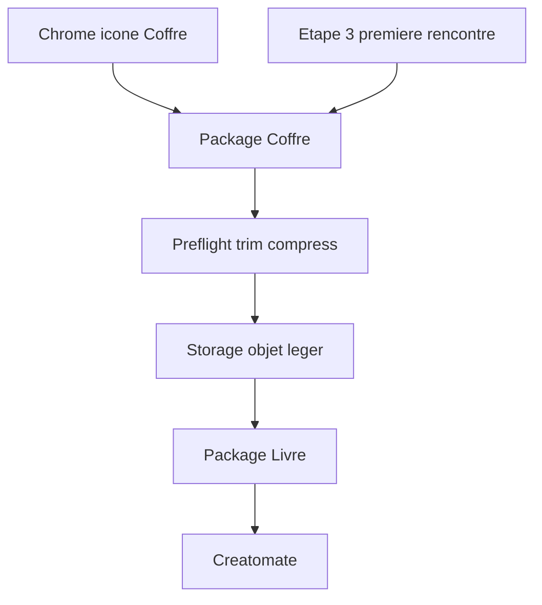

# Wizard — packages Coffre / Livre + ingest

**Type :** living · **Vérité pour :** chantier post-deck — découpage Coffre/Livre en packages, tiroir global, ingest trim/compress.  
**Dernière MAJ :** 27 oct 2026 · **Carte :** [`../README.md`](../README.md)

**Changelog** (max 5)
- 27 oct 2026 — **Cadrage Livre** figé (3a extraction → 3b L2/K/J) · labels S5-L2 universels · état code Phase 1 ✅ / S7 ⏳.
- 14 oct 2026 — **C3.2** tiroir : barre compacte collante · dépôt n’importe où · Scanner en haut du Coffre.
- 14 oct 2026 — **C3.1** tiroir Coffre à gauche 75 % · pastille + compteur signature en-tête.
- 14 oct 2026 — **Phase 1 C3 ✅** tiroir = même `CoffreBody` · un seul monté · upload continue tiroir fermé.
- 14 oct 2026 — Phase 1 C1–C2 : `src/surfaces/coffre/CoffreBody` + compteur forfait.

Canon liés : [`COFFRE_MONTAGE_MEDIA_INGEST.md`](COFFRE_MONTAGE_MEDIA_INGEST.md) · [`../WIZARD_ARCHITECTURE.md`](../WIZARD_ARCHITECTURE.md) · [`../STORYBOARD_STEP5_LIVRE_OUVERT.md`](../STORYBOARD_STEP5_LIVRE_OUVERT.md) · tiroir J5 [`SANCTUARY_USER_JOURNEY.md`](SANCTUARY_USER_JOURNEY.md).  
Audit docs cluster oct : [`DOCS_AUDIT_WIZARD_CLUSTER_2026-10-08.md`](DOCS_AUDIT_WIZARD_CLUSTER_2026-10-08.md) (**supersédé** 27 oct ; vérité = ce fichier + [`../PROJECT_STATUS.md`](../PROJECT_STATUS.md)).

---

## Décisions

| Décision | Choix |
|----------|--------|
| Forme | **Packages / surfaces** dans ce repo — pas un 2ᵉ Next app déployable V1 |
| UX B | Dette code **+** irritants (Coffre accessible en tiroir / toujours, + polish) |
| Ordre | **Coffre** (package + tiroir + ingest) → **Livre** (package + polish après cadrage Erik) |
| Ingest V1 | Client trimme / compresse **avant** upload · **un seul** objet Storage · copy « versions allégées seulement » |
| Soft Cap | Silence dans le Coffre (canon Soft Cap) |
| Badges tuile | **Un** badge / tuile — provenance avant nature (Scanner → Souvenir → Vidéo → Photo) |

---

## Badges grille Coffre (étape 3)

Canon UI : [`MediaQueueGrid.tsx`](../../src/components/media/MediaQueueGrid.tsx) · copy `tributeWizard.queueVia*`.

| Badge | Clé FR/EN | Condition | Couleur (identité, pas sélection) |
|-------|-----------|-----------|-----------------------------------|
| **Scanner** | `queueViaScanner` | `source === scanner_companion` | Indigo — texte `#a5b4fc`, bordure + glow |
| **Souvenir** | `queueViaGuest` | `source` préfixe `guest_` | Teal — texte `#5eead4` |
| **Vidéo** | `queueViaVideo` | Upload famille vidéo (sinon) | Ambre — texte `#fcd34d` |
| **Photo** | `queueViaPhoto` | Upload famille photo (défaut) | Mauve / fuchsia — texte `#f5d0fe` |

Style : fond noir ~75 %, bordure + texte saturés, glow léger — **pas** pastille plein fond coloré.  
Sélection / « Envoyé » restent teal (état) — [`DESIGN_SYSTEM.md`](../DESIGN_SYSTEM.md) « choisir = teal ».

---

## État code (27 oct 2026)

| Surface | Réalité | Cible chantier |
|---------|---------|----------------|
| Orchestrateur | [`TributeWizard.tsx`](../../src/components/tribute/TributeWizard.tsx) **~3312 L** | Alléger encore (nav, gates, chrome, wiring) |
| Coffre | **Phase 1 ✅** [`src/surfaces/coffre/`](../../src/surfaces/coffre/) — `CoffreBody` (étape 3 `onboarding` + tiroir `drawer`) · `CoffreDrawerShell` · `CoffreDrawerTrigger` | Un seul `CoffreBody` monté · tiroir monté tant qu’un upload tourne |
| Livre | [`StoryboardMontageStep.tsx`](../../src/components/tribute/StoryboardMontageStep.tsx) ~723 L + `montage/*` + `storyboard/*` | `src/surfaces/livre/` après S7 (cadrage § Phase 3) |
| Vidéo | S5 poster ✅ · upload **as-is** · `videoTrims` non écrit par l’UI | **S7 ⏳** : picker 10,0 s + encode 1080p client |
| Photo | **S6 ✅** resize ≤2048 JPEG avant upload + thumb WebP · HEIC = original (canvas) | Copy « allégé » avec S7 |

---

## Phase 1 — Package Coffre + tiroir ✅

Livré 14 oct : extraction `CoffreBody` · tiroir chrome wizard · même banque étape 3 · Scanner en haut · compteur forfait.

Reste vision Journey : unifier tiroir ciel / studio (J5 partiel : wizard OK, ciel/studio non).

---

## Phase 2 — Ingest coût (canon S5–S7)

Détail technique : [`COFFRE_MONTAGE_MEDIA_INGEST.md`](COFFRE_MONTAGE_MEDIA_INGEST.md) §3–4.

| Slice | Quoi | Done when |
|-------|------|-----------|
| **S5** | ✅ Poster frame vidéo client à l’upload | Tuile Coffre / banque = image |
| **S6** | ✅ Resize photo ≤2048 px preflight (JPEG 0.82 · HEIC skip) | Plus d’upload « plein capteur » V1 (JPEG/PNG) |
| **S7** | Trim 10 s + encode 1080p H.264/AAC + UX préparation | Fichier léger · Creatomate `trim_start` = 0 |
| **Copy** | Famille informée : on ne garde que la version préparée / allégée | Clés FR/EN + catalog |

Ancrage : [`mediaUploadService.ts`](../../src/lib/uploads/mediaUploadService.ts) · [`resizeImageForUpload.ts`](../../src/lib/media/resizeImageForUpload.ts). Ops : plafond Supabase Storage 100–300 Mo.

---

## Phase 3 — Package Livre + polish

### Cadrage Erik (27 oct 2026) — priorités figées

Zéro commit UX Livre tant que S7 n’est pas derrière la porte QA. Décisions :

| # | Décision |
|---|----------|
| 1 Scope | **3a** extraction pure (`surfaces/livre/` + cleanup orphelins) ; **3b** polish ensuite. Pas mélanger refactor DnD et UI/audio. |
| 2 Priorité polish | **S5-L2** → **S5-K** → **S5-J** → (4) matière/mobile |
| 3 Labels S5-L2 | Ch1 Racines & Premiers Pas / Roots & Early Days · Ch2 Au Cœur de la Vie / At the Heart of Life · Ch3 Passions & Lumière / Passions & Light · Ch4 Liens & Partages / Bonds & Shared Moments · Ch5 Empreinte & Souvenir / Lasting Imprint. Progression universelle, non chronologique forcée. Plus de Legacy/Horizons. |
| 4 Gate co-créateur | Assez visible ; pas de refonte avant extraction |
| 5 filmBridge | Hors scope Livre ; beat entrée **étape 4** |
| 6 Copy host | Blob copy typé injecté par TributeWizard (miroir Coffre) |
| 7 Coffre↔Livre | `coffreMediaRevision` + refetch `{ force: true }` ; pas de store global |
| 8 Hors Phase 3 | Warnings pacing UI · mix BA · purge `actTracks` (S8–S10) |

| Priorité | Chantier Livre | Dépendance |
| :--- | :--- | :--- |
| **P0 — Phase 3a** | Extraction vers `src/surfaces/livre/` (contrat host + copy injectée + `coffreMediaRevision`) et suppression des orphelins (`MontageTimeline`, `MediaBankPanel`) | Après S7 ingest |
| **P1 — Phase 3b** | S5-L2 (labels chapitres universels) → S5-K (Focus organique) → S5-J (Audio chapitre au montage) | Après 3a |
| **Later** | Polish tactile mobile M0–M6, Gate co-créateur, warnings pacing UI et purge `actTracks` | Post-V1 / S8–S10 |

### Implémentation (après S7)

1. Extraire montage + libs storyboard/DnD/magie vers `src/surfaces/livre/` (3a).
2. Polish L2 → K → J (3b) selon le tableau ci-dessus.
3. Contrat host assez propre pour un futur consommateur hors Odyssey — sans 2ᵉ deploy maintenant.

---

## En parallèle — alléger TributeWizard

Sortir helpers locaux ; garder nav / gates / checkout. Cible mentale : orchestrateur bien sous ~1000 L — pas de big-bang.

---

## Risques

- Drawer ≠ 2ᵉ source de vérité (un seul cache médias).
- Encode client (S7) : perf mobile · copy préparation · fallback échec.
- Promesse « allégé seulement » : copy + Storage doivent matcher.
- Livre : pas de dual-write storyboard pendant l’extraction.

---

## Ordre de ship

1. Package Coffre + tiroir chrome wizard  
2. ~~S5~~ ✅ → ~~S6~~ ✅ → S7 + copy rétention allégée  
3. Cadrage Livre → package + polish  
4. Unifier tiroir ciel / studio si pas déjà fait en P1  
